# dalin.dev

My portfolio site: **[dalin.dev](https://dalin.dev)**. One static `index.html`, served by GitHub Pages, with no framework and no build step.

  

The panel above is a replay. On the site, the classifier trains in your browser and you can type your own question.

## Portfolio site 2026.2

Refreshed from the Nov 2026 resume (Senior AI Developer) plus notes on my agent team. The first screen is a question box, and behind it is a small neural network that trains from scratch in the visitor's browser on every page load.

### 01 · Ask the model

A visitor types a question about my work and gets an answer that streams out token by token, next to a live picture of the network that helped pick it. There are no API calls and no large language model, and nothing typed leaves the browser.

#### The classifier (real)

It is a feed-forward classifier, not a transformer. It reads a question and gives a probability to each of the 44 answers.

| Part | Size | Parameters |
|---|---|---|
| Input | 1,024 hashed slots | none |
| Input → hidden | 1,024 × 64 | 65,536 |
| Hidden → output | 64 × 44 | 2,816 |
| Biases | 64 + 44 | 108 |
| **Total** | | **68,460** |

- **Input.** There is no vocabulary. The question is split into words, word pairs and letter triples, and each piece is hashed to one of 1,024 slots. Any word lands somewhere, and the letter triples are why a typo still lands close.
- **Hidden layer.** One layer of 64 ReLU units. The picture draws them as four columns of 16 so they fit; it is still one layer.
- **Output.** A softmax over the 44 answers. The picture shows the top 7 with their probabilities.
- **Training.** On page load, in plain JavaScript: 8 passes over 933 pairs (a keyword or example question, and the answer it should pick). That takes about 70 ms on a laptop, and it runs in ~12 ms slices so scrolling never stutters. The weights start random, so the numbers differ a little on every visit. The console title shows the real time for that visit.
- **Feedback.** 👍 and 👎 each run one real gradient step (learning rate 0.04, gradient clipped) that makes the shown answer more or less likely for that question. The steps are kept in `localStorage` (`dalin-lm-feedback-v1`, last 100) and replayed after training on the next visit. They never leave the browser.

#### How an answer gets picked

1. **Keywords.** Each answer has keys in `KB`. Multi-word keys (`'agent island'`) match as phrases and outweigh single words. One-letter typos still match.
2. **Similar questions.** Each answer has example questions in `KB_QUESTIONS`. The visitor's question is normalised (current→now, job→role, plurals) and compared with every example by idf-weighted cosine similarity.
3. **The classifier.** It decides only when the first two find nothing solid, and only if it recognises at least one word.
4. **Otherwise** the page says it doesn't know.

The classifier goes last because it is the weakest of the three. On 40 new phrasings, measured before they were added as examples, keywords plus similar questions got 27 right and the classifier alone got 20–26. The picture always shows its guess, and the stats line says what picked the answer.

To cover a new phrasing, add one line to the right list in `KB_QUESTIONS`. The next page load trains on it.

#### What is real and what is simulated

| Panel | Status |
|---|---|
| Classifier picture, parameter count, hidden units, answer probabilities | Real, drawn from the live weights |
| Embeddings (64 learned numbers per word) | Real |
| 👍 / 👎 backprop | Real, one gradient step |
| Similar-question score | Real cosine similarity |
| Token splits, token ids, attention arcs | Simulated, to show how an LLM works |
| Next-token probabilities, tokens per second | Simulated playback of a pre-written answer |
| Scores beside resume sections in RETRIEVED CONTEXT | Simulated |

The answers were written ahead of time from my resume and notes, so the page can't invent facts, though it can pick the wrong answer. Asking "is this a real LLM?" or "how does this work?" gets this same explanation and opens the **How this works** section, which has one card per stage.

#### Other details

- A light circles the question box while it is idle, and the box lights up solid on focus.
- The page asks `AI` once by itself as a demo.
- Every answer ends with "Ask next" chips (`KB_NEXT`), and "tell me more" gives a deeper second answer where one exists (`KB_MORE`).
- Answers can carry links written as `[text](url)`.
- Salary, visa, notice period and similar questions get an honest "let's talk directly" answer.
- Open questions (where AI is going, who inspires me, hobbies, side projects) are answered in my own words. Off-topic questions get "I don't know".

### 02 · The agent office

A procedural Three.js scene of my personal agent team (Grok bots plus Claude Code, 14 desks), with no model files. Three.js r147 is lazy-loaded from jsDelivr when the office scrolls near.

- Tickets flow inbox → Chief of Staff → Eng → QA → Security → Eng Manager.
- Autonomy is earned. Kinds of change that have built up trust ship by themselves, prod deploys, data writes and migrations included. New and long-tail ones stop at the human gate. The direction is from 10% automated toward 99%, with a person on the last 1%.
- Second and third rows: Incident (wakes on a red Status Island tile), Data Healer, Evals, Research, Cost Scout, Billing Watch, Stack Scout, OSS, and local Claude Code.
- Desk labels show only a name until a desk is handling a ticket, selected or hovered. Drag or swipe to rotate; click a desk for details.

### 03 · Knowledge map

A radial "career clock". The inner ring shows roles as arcs by date (2015 → now), and the outer ring shows 58 skills in six domains by depth. Hover or tap a skill to trace where it was used, with years, a line of evidence and projects. Search also takes vendor and older names through each skill's `aka` list (`openai` → LLM APIs, `php` → Early web stack). It tours itself until touched.

### 04 · Experience, 05 · Projects, 06 · Consoles

Experience and projects come from the same data objects as the map. The consoles at the bottom are labelled as a replay: the agent-team log, and a LoRA fine-tuning monitor shaped like a real run (3 epochs × 750 steps, warmup then cosine learning rate, eval every 250 steps). Those numbers are illustrative.

### Working on it

- **Content.** Edit `ROLES`, `SKILLS`, `PROJECTS`, `KB` (answers), `KB_QUESTIONS` or `OFFICE_AGENTS` in the data `<script>` near the top of `index.html`.
- **Preview.** Serve the folder with any static file server and open it. There is nothing to install.
- **Deploy.** GitHub Pages serves `master`.
- **Sizing.** The page scales like browser zoom. All CSS sizes are in `rem`, and the root size grows with the window: 16px up to 1440px wide, about 19px at 1920, capped at 22px. Text drawn on canvas uses `uiPx()` so it scales the same way.

Built with Claude Code (Fable 5.2).

#### Easter eggs
- Click `v2026.2` (top bar or footer) to cycle previous versions, including `index_2026.html` (v2026.1).
- Ask the model `matrix` or `42`, try a prompt injection on it, or press the Konami code.
- Click the `● ONLINE` dot 5×. Click the turtle in the office lounge.
- Append `?boot=1` to the URL to re-run the boot sequence.

---

## Earlier versions

The old pages are still live. Clicking `v2026.2` on the site cycles through them.

| Version | What it was |
|---|---|
| [2026.1](https://dalin.dev/index_2026.html) | "Mission Control": a 3D graph of roles, projects and skills, a virtual office, and live terminals. [Walkthrough video](https://github.com/user-attachments/assets/65ab1a49-e1a5-4be4-81cb-3916b7e0838d). |
| [2024](https://dalin.dev/index_2024.html) | A complete rewrite with Claude 3.5 Sonnet as a plain static page, with 100% Lighthouse scores on mobile and desktop. |
| [2023](https://dalin.dev/index_2023.html) | Rewritten with GPT-4. |
| [2017](https://dalin.dev/index_2017.html) | The original: terminal-style About Me, a blockchain-styled experience section, particles. |

The domain moved to dalin.dev in May 2022.
